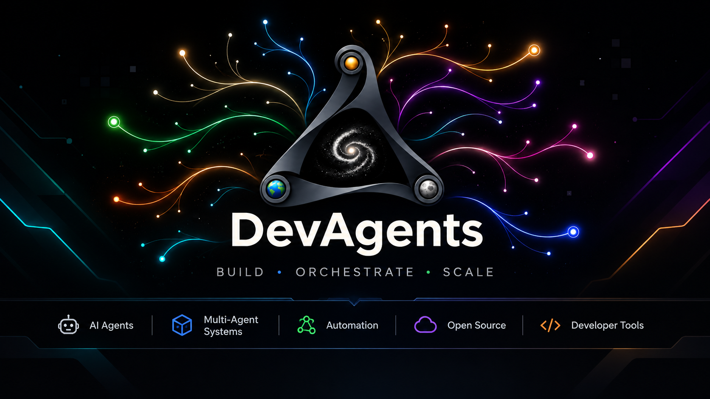
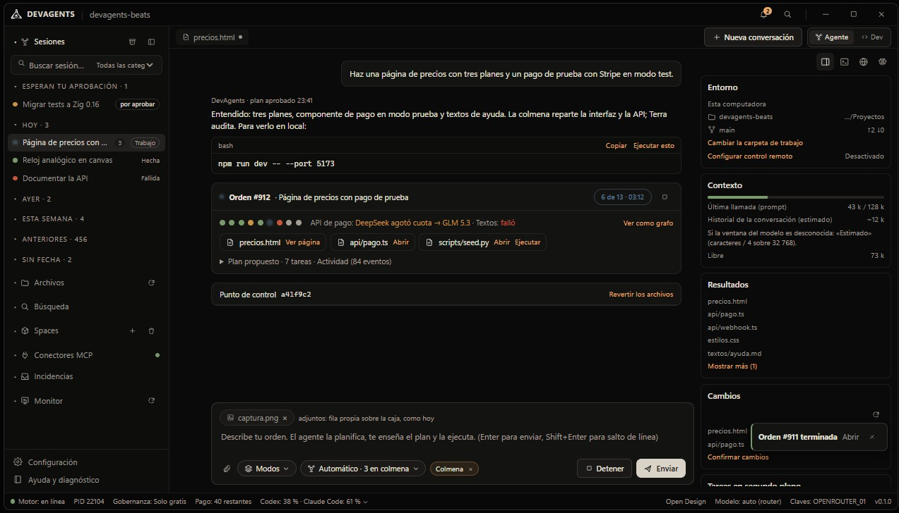
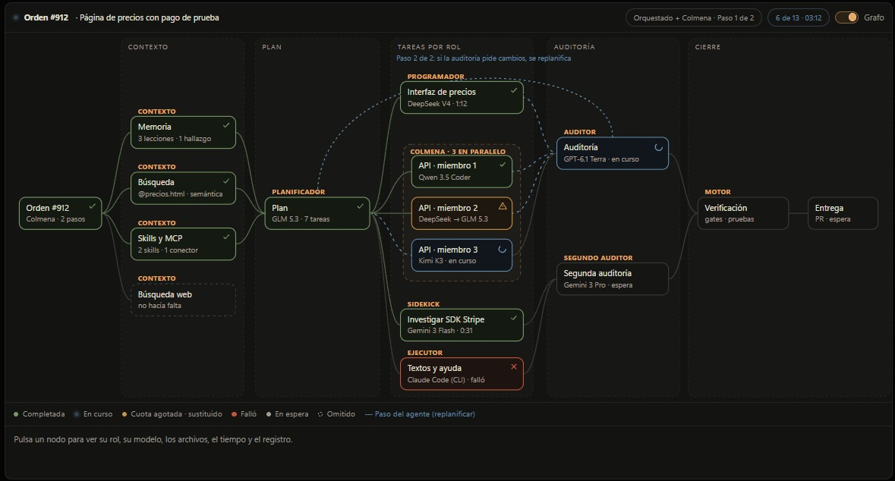

# DevAgents

[English](README.md)

**DevAgents es un entorno de desarrollo con agentes (ADE), libre y gratuito, en beta.** La cabina gráfica es para Windows 10/11 de 64 bits; el motor, la CLI y el servidor MCP también funcionan en Linux. Puedes trabajar con un modelo en Directo o repartir una orden entre varios modelos en Orquestado y Colmena. Las capacidades y sus límites se detallan abajo con evidencia del repositorio.

> **Corte documental: 20-nov-2026.** El código es público bajo Apache-2.0; todavía no hay binarios ni instalador publicados: hoy se compila desde el código fuente. Hay un paquete instalable construido y probado en el equipo de desarrollo; falta el recorrido en una máquina limpia. [Informe del paquete](docs/evidencia/FASE0-20261110/T4-informe-20261113.txt).







[Captura de la cabina](docs/img/devagents-cabina.png), tomada el 10-nov-2026 en el equipo de desarrollo. Es una imagen de esa sesión, no una prueba de todos los flujos actuales.

La interfaz gráfica está traducida al inglés y al español (se elige en Ajustes); la ayuda de la CLI responde en inglés con `DEVAGENTS_LANG=en`, aunque el resto de la salida de la CLI sigue en español. [Validación i18n](docs/evidencia/FASE1-20261120/VALIDACION-INTEGRAL-20261120.txt).

## Qué hace y qué se comprobó

«Probado» se refiere a la ejecución fechada que se enlaza, en el equipo de desarrollo. Una prueba automatizada o una revisión de código no equivale a un recorrido en vivo.

| Pieza | Para qué sirve | Estado y evidencia |
|---|---|---|
| **Directo** (por defecto) | Conversar con un solo modelo, leer y editar el proyecto y ejecutar herramientas. No añade la auditoría de Orquestado. | Hay órdenes reales documentadas; no implica que todos los proveedores estén probados. [Contraste A1, A9 y A16](docs/evidencia/FASE0-20261110/R3-anuncio-contra-codigo-20261112.txt). |
| **Orquestado** | Planificar, repartir tareas en espacios de Git y someter la entrega a auditoría de otro fabricante y comprobaciones deterministas. | Hay recorridos anteriores y órdenes reales con entrega en disco (CLI, 20-nov-2026); falta el recorrido final de la versión actual con fallo deliberado. No se ha demostrado que el gobierno detecte fallos reales sin falsas alarmas. [Contraste A9 y A16](docs/evidencia/FASE0-20261110/R3-anuncio-contra-codigo-20261112.txt), [validación integral](docs/evidencia/FASE1-20261120/VALIDACION-INTEGRAL-20261120.txt). |
| **Colmena** | Elegir varios modelos y sus papeles para construir y auditar. | **Recorrido en vivo el 20-nov-2026**: orden real con 4 modelos gratuitos de 2 fabricantes (OpenRouter y Cohere, sin modelos locales), entrega de archivos verificada en disco y puerta semántica superada; el router recuperó un fallo de proveedor cambiando de fabricante. Falta un recorrido con fallo de auditoría y corrección. [Validación integral](docs/evidencia/FASE1-20261120/VALIDACION-INTEGRAL-20261120.txt). |
| **Mejor de N** | Comparar soluciones de varios proveedores en espacios separados. | Construido; **sin probar en vivo en esta revisión**. No se promete una calidad superior. [Revisión de código](docs/evidencia/FASE0-20261110/T10-sol-informe.txt). |
| **Modo DevAgents** | El agente principal delega partes independientes a subagentes. | Hay evidencia de dos subtareas integradas; la delegación propia tiene un nivel, no subagentes anidados. [Contraste A16–A17](docs/evidencia/FASE0-20261110/R3-anuncio-contra-codigo-20261112.txt). |
| **API y modelos locales** | Registrar proveedores por API y conectar Ollama. | API usadas en órdenes reales. **Ollama probado en vivo**: orden real con modelo local que planificó y escribió su artefacto en disco (17-nov-2026, cierre B5). [Contraste A7 y A12](docs/evidencia/FASE0-20261110/R3-anuncio-contra-codigo-20261112.txt), [validación integral](docs/evidencia/FASE1-20261120/VALIDACION-INTEGRAL-20261120.txt). |
| **CLI externas** | Usar Claude Code (Anthropic), Codex (OpenAI), Gemini CLI (Google) u OpenCode con su configuración y acceso a modelos. | Matriz real: 9 combinaciones de permisos con Claude Code, Codex y OpenCode; no cubre todas las versiones o modos. Gemini CLI sigue sin orden real comprobada. [Salida de la matriz](docs/evidencia/FASE0-20261110/T2-matriz/matriz-1.log). |
| **Cuentas y reglas del proyecto** | Cuentas aisladas de Codex y Claude Code, rotación por cuota y reglas editables por proyecto. | Construidas y probadas con dobles; login y rotación reales **sin probar en vivo**. No se ofrecen cuentas aisladas de Gemini CLI ni OpenCode. Las reglas del proyecto se aplican a los modos y CLIs; las reglas del repositorio/las reglas del repositorio tienen prioridad. [Informe T7](docs/evidencia/FASE0-20261110/T7-informe-20261113.txt). |
| **MCP y CLI nativos** | `devagents-mcp.exe` por stdio; `devagents.exe` como alias de `devagents-core.exe`. MCP expone 121 herramientas y negociación de versiones, archivos, terminal, Git, planes y espacios; no permite aflojar el gobierno. La CLI tiene ayuda en inglés con `DEVAGENTS_LANG=en`; el resto de la salida de la CLI sigue en español. | Protocolo y herramientas comprobados por pruebas y cliente stdio; **sin probar en vivo desde una IDE externa real**. [Superficie y límites](docs/MCP-SURFACE-MAP.md), [prueba stdio](docs/evidencia/FASE0-20261110/QA-B-mcp-real.txt), [validación integral](docs/evidencia/FASE1-20261120/VALIDACION-INTEGRAL-20261120.txt). |
| **Navegador del agente** | 15 herramientas para inspeccionar e interactuar con páginas; apoyo para iniciar y consultar un servidor de la aplicación. | Pruebas del host y de Chromium; falta recorrer las herramientas nuevas con una orden real dentro de WebView2. **Sin probar en vivo ese flujo.** [Informe T6](docs/evidencia/FASE0-20261110/T6-informe-20261113.txt). |
| **Grafo de la orden** | Representar tareas, auditorías, grupos paralelos, memoria y replanificación con eventos del motor. | Eventos y renderizado probados; la captura T8 es sintética. Falta el recorrido final con una orden real. [Informe](docs/evidencia/FASE0-20261110/T8-eventos-y-grafo.txt), [captura sintética](docs/evidencia/FASE0-20261110/T8-grafo-sintetico.png). |
| **Paquete y diagnóstico** | Instalador de Windows y comando `doctor` para revisar el entorno. | Instalación y prueba de humo en el equipo de desarrollo; `doctor` ejecutado realmente. Falta máquina limpia y publicación. [Informe T4](docs/evidencia/FASE0-20261110/T4-informe-20261113.txt). |
| **Actualizador** | Avisar de versiones y aplicar al cerrar, con consentimiento y sin órdenes en curso. | Piezas probadas; **sin probar en vivo una actualización completa** desde una versión publicada. No hay certificado de editor: hoy toda actualización exige aceptar «sin firma verificable». SHA-256 no acredita al editor. [Informe T5](docs/evidencia/FASE0-20261110/T5-informe-20261113.txt), [prueba del consentimiento](docs/evidencia/FASE0-20261110/T12A-M3-update-ui.txt). |
| **Entrega a una forja** | Preparar rama, commit y pull request tras aprobación. | Construido; **sin probar en vivo** contra GitHub, GitLab o Gitea reales en esta revisión. [Revisión de código](docs/evidencia/FASE0-20261110/T10-sol-informe.txt). |

## Instalar y dar la primera orden

**Hoy no hay binarios descargables ni instalador publicado.** Las instrucciones siguientes son para compilar desde el código fuente. El paquete existente no equivale a una versión publicada ni a una instalación validada en máquina limpia. [Estado del paquete](docs/evidencia/FASE0-20261110/T4-informe-20261113.txt).

Requisitos: Windows 10/11 de 64 bits, WebView2, Git para trabajar con espacios y Zig 0.16.0 y Node.js para compilar. Mantén al menos 15 GiB libres para el trabajo de compilación y pruebas. Estos pasos se contrastaron con el lanzador y la configuración de construcción; **sin probar en vivo una instalación limpia en esta revisión**. [Detalle de revisión](docs/evidencia/FASE0-20261110/T10-sol-informe.txt).

1. Clona este repositorio y abre su carpeta.
2. Ejecuta `DevAgents.bat`. Comprueba las dependencias; si falta Zig ofrece descargarlo en `toolchain\` y comprueba su SHA-256. Si falta Node.js ofrece instalar LTS con `winget`. **Los diálogos de instalación aceptan por defecto tras 20 segundos**; usa `/nodeps` si quieres impedir instalaciones automáticas. El lanzador comprueba/compila y abre la cabina en cada ejecución.
3. Elige una carpeta de proyecto de prueba. En **Configuración › Proveedores**, añade tu proveedor, o configura una CLI detectada en **Agentes externos**. El proveedor o la suscripción pueden tener sus propios costes.
4. Selecciona **Directo** y un modelo disponible. Envía una primera orden pequeña: «Lee esta carpeta y describe sus archivos sin modificarlos». Revisa la respuesta y las solicitudes de permiso antes de pedir cambios.

Las opciones leídas en el lanzador son `/rebuild` (compilación completa), `/ui` (solo interfaz), `/nodeps` (no instalar dependencias), `/devtools` (depuración) y `/limpiar` (borra caché y binarios y sale). El flujo anterior es una guía de inicio, **sin probar en vivo de punta a punta en esta revisión**. [Revisión del lanzador](docs/evidencia/FASE0-20261110/T10-sol-informe.txt).

Con Zig y Node.js ya preparados, desde la raíz:

```powershell
zig build runtime-binaries -j1
.\zig-out\bin\devagents-core.exe doctor
.\zig-out\bin\devagents-host.exe
```

Los nombres y el destino se contrastaron con `build.zig`; estos comandos no se ejecutaron en esta revisión. [Detalle de revisión](docs/evidencia/FASE0-20261110/T10-sol-informe.txt).

| Archivo en `zig-out\bin` | Uso previsto |
|---|---|
| `devagents-host.exe` | Cabina gráfica de Windows |
| `devagents-engine.exe` | Proceso del motor |
| `devagents_core.dll` | Biblioteca del motor |
| `devagents-core.exe` / `devagents.exe` | CLI; el segundo es un alias del mismo binario |
| `devagents-mcp.exe` | Servidor MCP por stdio |

Para configurar MCP, consulta la [matriz de superficie y autenticación](docs/MCP-SURFACE-MAP.md). Conectar desde una IDE externa real sigue **sin probar en vivo**.

### Linux (motor, CLI y MCP; beta)

**Beta: motor, CLI y MCP; sin cabina gráfica.** En un contenedor Ubuntu 24.04 (Docker sobre WSL2, sin red) la suite del motor pasó el 17-nov-2026: 24/24 pasos, 2276/2492 pruebas y 216 omitidas, cada una con su motivo (semántica solo de Windows o CLI externa no disponible). Hay un paquete `.tar.gz` con `devagents`, `devagents-mcp`, `key-admin`, `LICENSE` y `NOTICE`, probado en un contenedor limpio: `--version`, `doctor`, claves en `~/.config/devagents` con permisos 0700/0600 y MCP por stdio con 121 herramientas. Una orden con el trabajador de prueba planifica y despacha, pero sin modelo real no hay auditoría y la entrega queda bloqueada («sin auditar»); **una orden con modelo real en Linux está sin probar en vivo**. La contención es parcial (`posix_partial`: grupo de procesos y límites por proceso; sin delegación de cgroup v2 no hay tope de procesos). Debian 12 es un objetivo **sin medir**. No hay paquete publicado. La cabina gráfica sigue siendo solo Windows. [Suite Linux](docs/evidencia/FASE0-20261110/T9-B-suite-linux-sol-4c.txt), [paquete](docs/evidencia/FASE0-20261110/T9-B-paquete-sol.txt), [orden y MCP](docs/evidencia/FASE0-20261110/T9-B-orden-mcp-sol.txt).

## Gobierno

El gobierno de Orquestado/Colmena combina auditoría de otro fabricante, comprobaciones de citas, presupuesto, política de comandos y registro encadenado. Si no hay veredicto usable se muestra «sin auditar» (`audit_unavailable`) y se bloquea la entrega. **Directo no añade esa auditoría.** Son mecanismos con revisión de código y pruebas; su eficacia sin falsas alarmas en un caso controlado de la versión actual sigue **sin probar en vivo**. [Contraste A9 y A16](docs/evidencia/FASE0-20261110/R3-anuncio-contra-codigo-20261112.txt), [guía de gobierno](docs/USER-GUIDE.md).

MCP mantiene las decisiones de permisos y gasto en la cabina; sus comandos pueden requerir una aprobación humana. No es paridad total con la interfaz. [Mapa MCP](docs/MCP-SURFACE-MAP.md), [salida de aprobaciones pendientes](docs/evidencia/FASE0-20261110/QA-B-mcp-real.txt).

## Privacidad: qué sale del equipo

La cabina guarda por defecto sus datos en **`%LOCALAPPDATA%\DevAgents-Angel`**. Las claves API de DevAgents se cifran con DPAPI de Windows; las credenciales de las CLI las administra cada CLI. Estas afirmaciones proceden de revisar código, no de una auditoría de tráfico. [Revisión de rutas y credenciales](docs/evidencia/FASE0-20261110/T10-sol-informe.txt).

**Local no significa que todo se procese sin red.** Según la configuración y las herramientas utilizadas:

- Los mensajes, contexto, memoria y contenido de archivos leído por el agente pueden enviarse al proveedor del modelo. En **Orquestado y Colmena intervienen varios modelos**: planificador, ejecutores y auditores, posiblemente de fabricantes distintos.
- **Claude Code → Anthropic, Codex → OpenAI y Gemini CLI → Google**; OpenCode utiliza los proveedores/modelos configurados en esa CLI. Cada herramienta externa tiene sus propias reglas de datos y telemetría, que DevAgents no controla.
- **`web_search`** envía consultas a Tavily o Brave Search si están configurados con clave; sin esa clave usa DuckDuckGo. **`web_fetch`** solicita las páginas públicas indicadas. El navegador integrado carga las páginas que abras tú o el agente.
- La detección y salud de modelos consultan proveedores; las entregas, incidencias, webhooks y notificaciones contactan los servicios configurados. El actualizador consulta GitHub Releases; se puede desactivar en Ajustes. El lanzador de desarrollo descarga dependencias.

[Contraste de salidas A15](docs/evidencia/FASE0-20261110/R3-anuncio-contra-codigo-20261112.txt), [revisión actual de buscadores, CLI y actualizador](docs/evidencia/FASE0-20261110/T10-sol-informe.txt).

No se encontró envío de sesiones a un servidor propio de DevAgents en el código revisado. Esto **no es una certificación de ausencia de tráfico**: tampoco acredita el comportamiento de WebView2 o de las CLI de terceros. [Contraste A13–A15](docs/evidencia/FASE0-20261110/R3-anuncio-contra-codigo-20261112.txt).

## Pruebas y CI

La última suite completa registrada sobre `main`, del **15-nov-2026**, terminó con **151/151 pasos, 2512/2518 pruebas aprobadas y 6 omitidas** (pruebas POSIX en Windows). Se ejecutó en el equipo de desarrollo; no es una ejecución de esta revisión documental ni demuestra todos los flujos en vivo. [Salida completa](docs/evidencia/FASE0-20261110/T12A-suite-completa-sobre-main-20261115.txt).

Existe un flujo de CI para Windows: en PR/push, formato, secretos, compilación, tipos, interfaz, puente y pruebas rápidas; de noche, suite completa. Los trabajos automáticos empezarán a correr con la publicación del repositorio; admite ejecución manual. Se comprobaron los comandos localmente, **sin ejecución alojada de CI acreditada**. Las acciones siguen fijadas por versión mayor, pendiente fijarlas por SHA. [Informe CI](docs/evidencia/FASE0-20261110/T11-T4-informe.txt).

## Lo que falta

- Publicar binarios, instalador y versiones descargables; certificado de editor y recorrido completo en máquina limpia.
- Recorrer MCP desde una IDE externa, login y rotación reales de cuentas, herramientas nuevas del navegador y actualización completa.
- Recorrer Colmena con fallo de auditoría deliberado y corrección; demostrar el gobierno sin falsas alarmas; entrega a forjas reales.
- Una orden con modelo real en Linux y medir Debian 12; i18n completa del runtime de la CLI y de las descripciones MCP.
- Ejecutar CI alojada tras la publicación y completar el contraste independiente de la versión final.

Estos límites no son funciones verificadas. El alcance documental y los pendientes consultados se detallan en el [informe de esta revisión](docs/evidencia/FASE0-20261110/T10-sol-informe.txt).

## Licencia, contribuir y apoyar

[Apache 2.0](LICENSE). Componentes de terceros: [NOTICE](NOTICE). Nombres y logotipos: [TRADEMARKS.md](TRADEMARKS.md).

Para contribuir, consulta [CONTRIBUTING.md](CONTRIBUTING.md) (firma DCO de commits) y [CODE_OF_CONDUCT.md](CODE_OF_CONDUCT.md). Comunica vulnerabilidades en privado según [SECURITY.md](SECURITY.md).

Puedes apoyar voluntariamente en **[Ko-fi](https://ko-fi.com/itlastudent)**, pagando lo que quieras (sugerido: 5 USD). La propuesta de edición fundador es para los primeros 10 000 apoyos; no desbloquea funciones. DevAgents se plantea gratuito, sin muro de pago; los servicios de modelos pueden cobrar por su uso. [Texto de apoyo](docs/evidencia/FASE-X/PUB-005/textos-kofi-y-pagina-20261110.txt).
